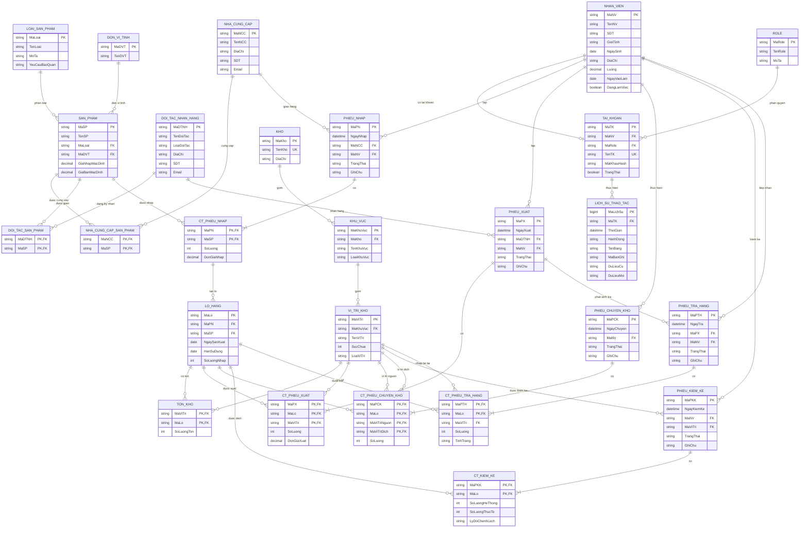

# Hệ thống quản lý kho hàng - ERD và nghiệp vụ

## 1. Các quyết định cần chốt trước khi code

ERD dưới đây giữ các thực thể trong tài liệu, đồng thời sửa/bổ sung các điểm cần thiết để hệ thống vận hành nhất quán:

1. Bổ sung `PHIEU_CHUYEN_KHO` và `CT_PHIEU_CHUYEN_KHO` vào danh sách chính thức. Hai bảng này có trong phần mô tả nhưng bị thiếu ở danh sách 23 bảng.
2. Sửa bảng `DOI_TAC_SAN_PHAM`: `MaDTNH` phải tham chiếu `DOI_TAC_NHAN_HANG`, không phải `NHA_CUNG_CAP`.
3. Bổ sung `MaViTri` vào `CT_PHIEU_XUAT`. Tồn kho được quản lý theo cặp `(MaViTri, MaLo)`, vì vậy chỉ có `MaLo` là chưa đủ để biết phải trừ hàng tại vị trí nào.
4. Đưa `TrangThai` lên đầu phiếu nhập/xuất thay vì đặt ở từng dòng chi tiết. Một phiếu chỉ được ghi sổ tồn kho đúng một lần khi chuyển sang trạng thái `DA_HOAN_THANH`.
5. Phiếu trả hàng tham chiếu phiếu xuất gốc bằng `MaPX`. Đối tác trả hàng được suy ra từ phiếu xuất, tránh lưu dữ liệu lặp và giúp kiểm tra số lượng trả không vượt số lượng đã xuất.
6. Bổ sung `LICH_SU_THAO_TAC` vì nghiệp vụ yêu cầu có nhật ký nhưng tài liệu chưa mô tả bảng.
7. Ràng buộc `TAI_KHOAN.MaNV` là `UNIQUE`, tương ứng một nhân viên có tối đa một tài khoản.

## 2. Code Mermaid ERD

## 3. Quy tắc dữ liệu quan trọng

- Số lượng trên chi tiết nhập, xuất, chuyển và trả phải lớn hơn 0; giá phải lớn hơn hoặc bằng 0.
- `HanSuDung >= NgaySanXuat` khi cả hai ngày có giá trị.
- Tồn kho không được âm. Mọi thao tác đọc-kiểm tra-cập nhật tồn phải nằm trong một transaction và khóa đúng dòng tồn kho.
- Tổng số lượng các lô tạo từ một dòng nhập không được vượt `CT_PHIEU_NHAP.SoLuong`.
- Xuất hàng chỉ được chọn lô còn hạn và nên ưu tiên FEFO (hạn dùng gần nhất xuất trước).
- Đối tác chỉ nhận sản phẩm đã khai báo trong `DOI_TAC_SAN_PHAM` nếu nhóm quyết định áp dụng danh mục hợp đồng.
- Vị trí nguồn và vị trí đích của một dòng chuyển kho phải khác nhau; lượng chuyển không vượt tồn tại vị trí nguồn; không vượt sức chứa vị trí đích.
- Số lượng trả cộng dồn theo phiếu xuất và lô không được vượt số lượng đã xuất.
- Chỉ phiếu ở trạng thái nháp được sửa/xóa. Phiếu đã hoàn thành không xóa vật lý; nếu cần đảo nghiệp vụ phải lập chứng từ điều chỉnh/hoàn trả.
- Mỗi phiếu chỉ được ghi sổ tồn đúng một lần. Cần cột trạng thái và kiểm tra chuyển trạng thái hợp lệ để chống nhấn nút hai lần.
- Mật khẩu phải lưu dạng hash, không lưu chuỗi mật khẩu gốc.

## 4. Các nghiệp vụ cần có

### P0 - Nền tảng bắt buộc

1. **Đăng nhập và phân quyền**: đăng nhập, khóa/mở tài khoản, đổi mật khẩu, kiểm tra quyền theo role.
2. **Quản lý nhân viên và tài khoản**: CRUD nhân viên; gán một role cho tài khoản.
3. **Quản lý danh mục hàng**: loại sản phẩm, đơn vị tính, sản phẩm, giá mặc định và điều kiện bảo quản.
4. **Quản lý đối tác**: nhà cung cấp, đơn vị nhận hàng và danh mục sản phẩm của từng đối tác.
5. **Quản lý cấu trúc kho**: kho, khu vực, vị trí; sức chứa và loại bảo quản.

### P1 - Luồng kho cốt lõi

6. **Nhập kho**: tạo phiếu nháp, thêm sản phẩm, duyệt phiếu, tạo lô, chọn vị trí cất hàng và tăng tồn.
7. **Tra cứu tồn kho**: xem tồn theo kho/khu vực/vị trí/sản phẩm/lô; tìm lô sắp hết hạn hoặc đã hết hạn.
8. **Xuất kho**: tạo phiếu, kiểm tra đối tác-sản phẩm, gợi ý lô theo FEFO, chọn vị trí lấy, kiểm tra đủ tồn và trừ tồn.
9. **Chuyển vị trí/chuyển kho**: chuyển một lô từ vị trí nguồn sang vị trí đích trong một transaction.

### P2 - Kiểm soát và hoàn thiện

10. **Kiểm kê và điều chỉnh**: chốt số lượng hệ thống, nhập số lượng thực tế, ghi nhận chênh lệch và điều chỉnh tồn sau khi duyệt.
11. **Trả hàng sau xuất**: chọn phiếu xuất gốc, kiểm tra giới hạn trả, phân loại tốt/hư hỏng và nhập về vị trí phù hợp.
12. **Báo cáo thống kê**: tồn hiện tại, giá trị tồn, nhập-xuất theo thời gian, hàng sắp hết hạn, chênh lệch kiểm kê, lịch sử chứng từ.
13. **Nhật ký thao tác**: ghi người dùng, thời gian, hành động, bảng/bản ghi và dữ liệu trước-sau đối với thao tác quan trọng.
14. **Xử lý lỗi và đồng thời**: rollback khi một bước thất bại; chống hai nhân viên cùng xuất vượt tồn; xử lý mất kết nối và dữ liệu không hợp lệ.

## 5. Đối tượng SQL Server nên triển khai để đạt rubric

### Stored Procedure

- `sp_DangNhap` hoặc thủ tục lấy thông tin tài khoản/role.
- `sp_HoanTatPhieuNhap`.
- `sp_HoanTatPhieuXuat`.
- `sp_HoanTatChuyenKho`.
- `sp_HoanTatKiemKe`.
- `sp_HoanTatTraHang`.
- `sp_TraCuuTonKho`.

Năm thủ tục hoàn tất chứng từ phải dùng `BEGIN TRANSACTION`, `TRY...CATCH`, `COMMIT/ROLLBACK`, đồng thời kiểm tra trạng thái để chống ghi sổ hai lần.

### Function

- `fn_TonTheoSanPham(@MaSP)`.
- `fn_TonTheoLo(@MaLo)`.
- `fn_TonKhaDungTaiViTri(@MaLo, @MaViTri)`.
- `fn_GiaTriTonKho(@MaKho)`.
- `fn_LoSapHetHan(@SoNgay)` dạng table-valued function.

### View

- `vw_TonKhoChiTiet`.
- `vw_TonKhoTheoSanPham`.
- `vw_LichSuNhapKho`.
- `vw_LichSuXuatKho`.
- `vw_LoSapHetHan`.
- `vw_ChenhLechKiemKe`.

### Trigger

Nên để stored procedure xử lý thay đổi tồn; trigger dùng làm lớp bảo vệ và audit:

- Kiểm tra nhà cung cấp có cung cấp sản phẩm khi thêm chi tiết nhập.
- Kiểm tra lô hàng có ngày sản xuất/hạn dùng hợp lệ.
- Chặn cập nhật `TON_KHO` làm số lượng âm hoặc vượt sức chứa vị trí.
- Chặn sửa/xóa chứng từ đã hoàn thành.
- Ghi audit cho thay đổi tài khoản/phân quyền.
- Ghi audit cho các lần hoàn tất hoặc hủy chứng từ kho.

### Index

- `SAN_PHAM(TenSP)`.
- `LO_HANG(MaSP, HanSuDung)` để chọn FEFO/cảnh báo hết hạn.
- `TON_KHO(MaLo) INCLUDE (MaViTri, SoLuongTon)`.
- `PHIEU_NHAP(NgayNhap, MaNCC)`.
- `PHIEU_XUAT(NgayXuat, MaDTNH)`.
- `LICH_SU_THAO_TAC(ThoiGian, MaTK)`.

### Role tối thiểu

- `Admin`: toàn quyền quản trị danh mục, nhân viên, tài khoản và phân quyền.
- `QuanLyKho`: duyệt chứng từ, quản lý danh mục kho và xem báo cáo.
- `NhanVienKho`: lập phiếu, thao tác nhập/xuất/chuyển/kiểm kê nhưng không quản trị tài khoản.
- `KeToan`: xem chứng từ, giá trị nhập-xuất-tồn và báo cáo; không trực tiếp sửa tồn kho.

`DoiTacNhanHang` là dữ liệu nghiệp vụ, không phải actor đăng nhập trừ khi nhóm thực sự xây cổng dành cho đối tác.

## 6. Thứ tự triển khai và điểm chia việc

1. Chốt ERD, trạng thái chứng từ và quy tắc ghi sổ tồn.
2. Viết script tạo bảng, khóa, check/default/unique và dữ liệu mẫu.
3. Hoàn thiện stored procedure cho 5 transaction cốt lõi và test đồng thời.
4. Xây API/service gọi stored procedure; không viết lại logic tồn kho ở giao diện.
5. Làm giao diện theo module: danh mục, nhập, xuất, tồn/chuyển, kiểm kê/trả, báo cáo.
6. Thêm phân quyền, audit, view/function/index; đo và lưu minh chứng index.
7. Chạy test tích hợp, test rollback, test hai người xuất cùng lúc; sau đó hoàn thiện báo cáo và demo.

Khi chia nhóm, nên giao theo **module dọc có thể demo được** thay vì chia một người chỉ làm giao diện và một người chỉ làm SQL. Mỗi thành viên phải có commit, test và hiểu cả luồng UI/API/SQL của phần mình để trả lời vấn đáp.
